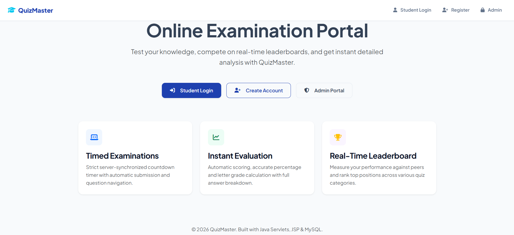
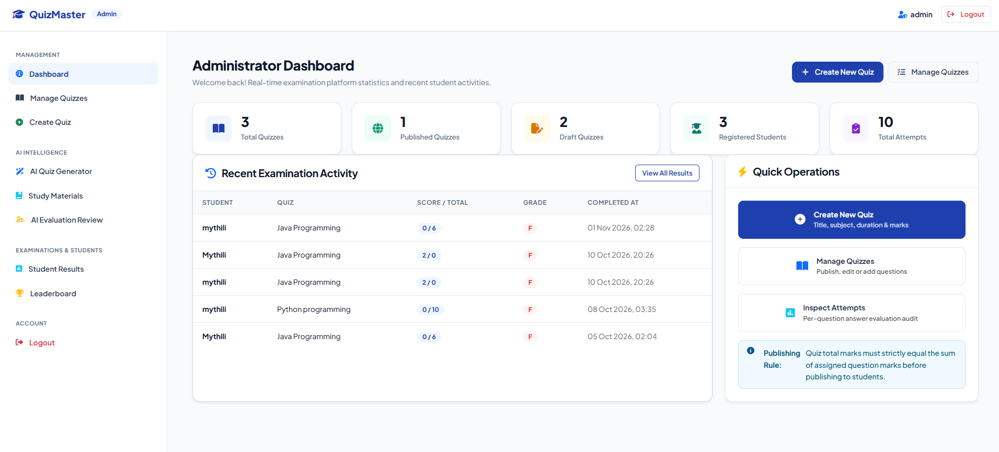
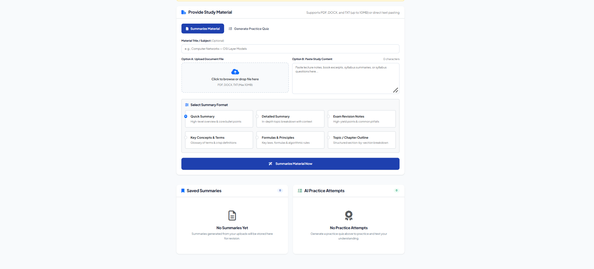
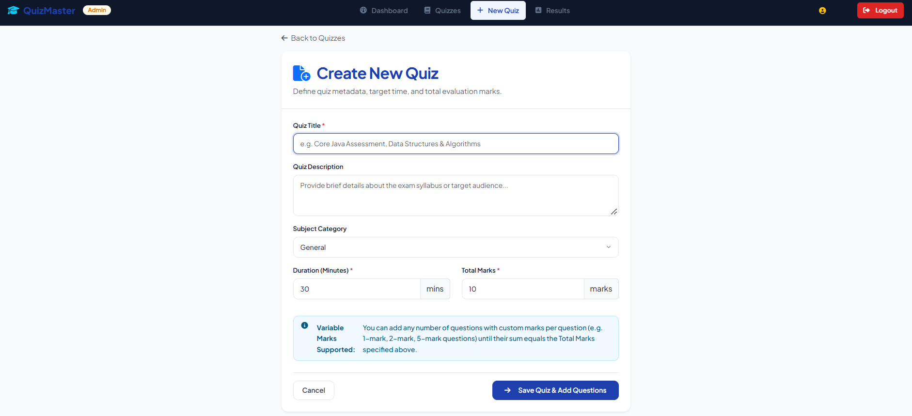
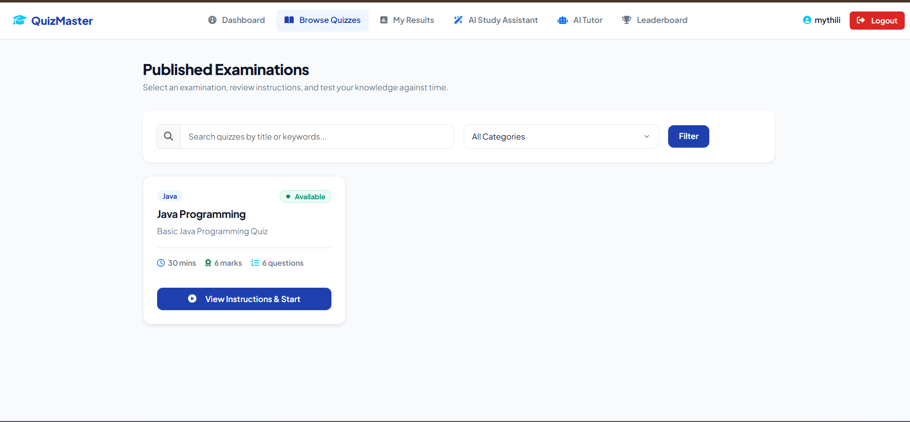
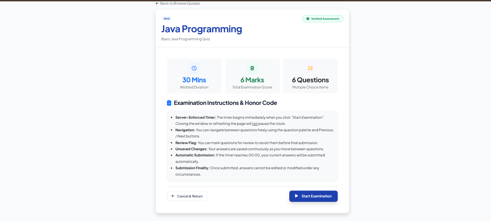
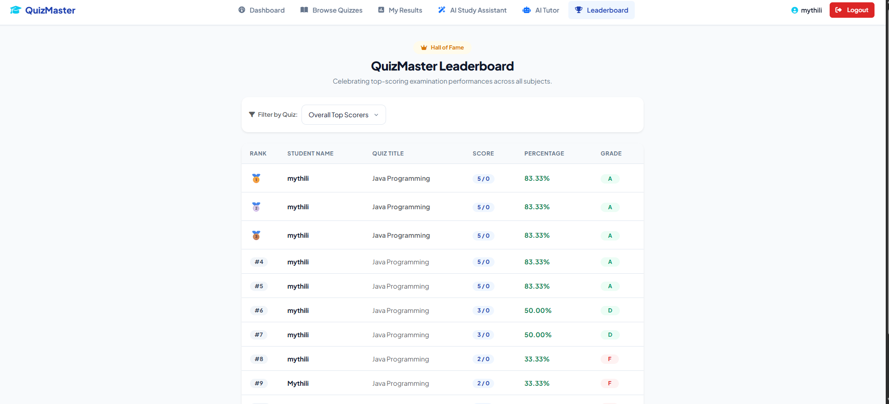

 # QuizMaster – Online Examination Portal

QuizMaster is a web-based Online Examination Portal developed using Java, JSP, Servlets and MySQL. It allows students to register, log in, attend online quizzes, view results and access study materials.

## Features

- Student Registration and Login
- Secure User Authentication
- Online Quiz Management
- Multiple Choice Questions (MCQs)
- Timer-Based Examinations
- Automatic Result Calculation
- Leaderboard
- Student Performance Tracking
- Study Materials
- AI-Based Quiz Generation
- AI-Based Descriptive Answer Evaluation

## Technologies Used

| Category | Technology |
|---|---|
| Frontend | HTML, CSS, JavaScript, Bootstrap |
| Backend | Java, JSP, Servlets |
| Database | MySQL |
| Connectivity | JDBC |
| Server | Apache Tomcat |
| Build Tool | Maven |
| IDE | IntelliJ IDEA |
| Version Control | Git and GitHub |

## Application Screenshots

### Homepage


### Login Page


### Admin Dashboard


### AI Assistant


### Create Quiz


### Examination Portal


### Exam Instructions


### Results


## Project Structure

```text
QuizMaster/
├── src/
│   └── main/
│       ├── java/
│       │   └── com/quizmaster/
│       └── webapp/
│           ├── css/
│           ├── js/
│           ├── images/
│           └── JSP pages
├── screenshots/
├── pom.xml
├── .gitignore
└── README.md
```

## Installation and Setup

1. Clone the repository.

```bash
git clone https://github.com/CHITTIMALLA-MYTHILI/QuizMaster.git
```

2. Open the project in IntelliJ IDEA.
3. Configure JDK 17 and Maven.
4. Install MySQL and create the required database.
5. Execute the project's SQL database script.
6. Configure your database connection details.
7. Configure Apache Tomcat.
8. Build and deploy the project.
9. Open the application in your browser.

```text
http://localhost:8080/QuizMaster/
```

## Future Enhancements

- Advanced analytics dashboard
- More AI-powered learning features
- Question difficulty levels
- Detailed student performance reports

## Author

Developed as an academic project.

## Repository

GitHub: https://github.com/CHITTIMALLA-MYTHILI/QuizMaster
